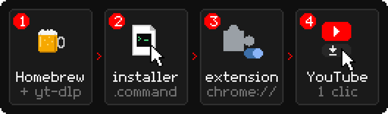
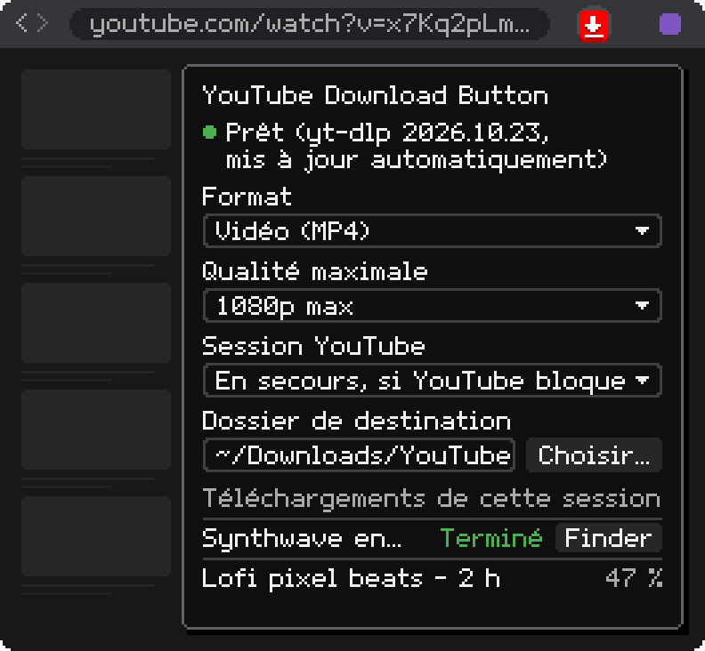

<p align="center">
  
</p>

# YouTube Download Button

Extension Chrome qui ajoute un bouton **Télécharger** juste à droite de *J'aime / Je n'aime pas*
sur les pages de vidéos YouTube, avec exactement le même design que les boutons natifs
(le bouton reprend les classes CSS de YouTube : mode clair, mode sombre et survol suivent).

Un clic télécharge la vidéo dans `~/Downloads/YouTube/` grâce à **yt-dlp**, en local, gratuitement
et sans limite. Le bouton affiche la progression (`12 %`), puis `Terminé`.

<p align="center">
  
</p>

Aucun serveur ne tourne en arrière-plan : Chrome lance lui-même un petit programme
(`host/ytb_dl_host.py`) au moment du clic, via le mécanisme *Native Messaging*, et ce
programme se termine quand le téléchargement est fini.

<p align="center">
  
</p>

```
DownloaderYtb/
├── extension/                 l'extension Chrome (Manifest V3)
├── host/
│   ├── ytb_dl_host.py         le programme lancé par Chrome (appelle yt-dlp)
│   └── installer.command      enregistre le programme auprès de Chrome (une fois)
└── docs/                      illustrations du README, dessinées par make_pixel_art.py
```

## Installation sur un ordinateur (une seule fois)

<p align="center">
  
</p>

Prérequis : Homebrew avec yt-dlp et ffmpeg.

```bash
brew install yt-dlp ffmpeg
```

1. Récupérer le dossier du projet (n'importe où, par exemple sur le Bureau) :
   `git clone https://github.com/Oksitaine/DownloaderYtb.git`, ou copier le dossier tel quel.
2. Double-cliquer sur `host/installer.command` dans le Finder
   (ou dans un terminal : `bash host/installer.command`).
   Le script copie le programme dans `~/Library/Application Support/YouTubeDownloadButton/`
   et l'enregistre auprès de Chrome, Brave, Edge, Arc et Chromium s'ils sont présents.
3. Ouvrir `chrome://extensions`, activer **Mode développeur**, cliquer
   **Charger l'extension non empaquetée** et choisir le dossier `extension`.
4. Ouvrir une vidéo YouTube : le bouton **Télécharger** apparaît après *J'aime / Je n'aime pas*.

Si macOS bloque le double-clic (« développeur non identifié »), faire clic droit → *Ouvrir*.

L'identifiant de l'extension est fixé par la clé dans `manifest.json`
(`lpccinmpoibiiophngcnjbhmooccncdg`), donc l'installation est identique sur toutes les machines,
quel que soit l'emplacement du dossier.

## Utilisation

<p align="center">
  
</p>

- **Clic sur le bouton** : téléchargement dans `~/Downloads/YouTube/`, nommé `Titre [id].mp4`.
- **Icône de l'extension** (barre d'outils) : état de yt-dlp et ffmpeg, **format** (MP4 par
  défaut, ou MP3), **qualité maximale** (meilleure disponible par défaut, ou un plafond de 240p à
  4K : si la vidéo n'existe pas dans cette qualité, la meilleure en dessous est prise),
  **dossier de destination** (bouton *Choisir…* qui
  ouvre le sélecteur de dossier macOS, ou chemin tapé à la main, vide = `~/Downloads/YouTube`)
  et liste des téléchargements de la session avec un bouton *Finder* pour afficher le fichier.
- Abonnés Premium : YouTube affiche déjà son propre bouton *Télécharger* (hors ligne, dans
  l'app). Le bouton de l'extension s'intitule alors *Télécharger MP4* (ou *MP3*) pour les distinguer.

## Mise à jour

Quand YouTube change quelque chose, yt-dlp le corrige en général en quelques jours :

```bash
brew upgrade yt-dlp
```

Après une modification de `host/ytb_dl_host.py`, relancer `host/installer.command` pour recopier
le programme. Après une modification du dossier `extension`, cliquer *Recharger* dans `chrome://extensions`.

Les illustrations de ce README sont des SVG en pixel art (animés en CSS), dessinés par
`docs/make_pixel_art.py` (bibliothèque standard Python uniquement) : `python3 docs/make_pixel_art.py`
les régénère.

## Détails techniques

- `extension/content.js` : injecte le bouton dans `#top-level-buttons-computed`, juste après
  `segmented-like-dislike-button-view-model`. Il copie les classes du bouton *Partager* voisin
  pour hériter du style YouTube, et bascule sur un style de secours si YouTube change ses classes.
  Le DOM est construit sans `innerHTML` (YouTube impose la politique *Trusted Types*).
  Les changements de page (YouTube est une SPA) sont suivis via `yt-navigate-finish` et un
  `MutationObserver`. Pendant un téléchargement, il interroge le service worker chaque seconde,
  ce qui maintient celui-ci actif.
- `extension/background.js` : vérifie à chaque chargement, activation ou (re)démarrage qu'un
  onglet YouTube contient bien le script du bouton, et l'injecte lui-même sinon (onglets restaurés
  au démarrage de Chrome, pages préchargées, onglets ouverts avant le rechargement de l'extension).
  Ouvre une connexion `chrome.runtime.connectNative` par téléchargement. Chrome lance alors `ytb_dl_host.py`, qui renvoie la progression et se termine
  à la fermeture de la connexion.
- `host/ytb_dl_host.py` : bibliothèque standard Python uniquement (Python 3 fourni par macOS).
  Protocole Native Messaging (JSON précédé de sa longueur sur 4 octets). Progression lue sur la
  sortie de yt-dlp (`--newline`), nom de fichier final via `--print after_move:filepath`.
  Variable d'environnement `YTB_DL_DIR` pour changer le dossier de destination.

## Dépannage

| Symptôme | Cause probable | Solution |
|---|---|---|
| *Erreur* + « Hôte natif non installé » | `installer.command` pas lancé | le lancer, puis *Recharger* l'extension |
| *Erreur* + « yt-dlp introuvable » | outils absents | `brew install yt-dlp ffmpeg` |
| « Sign in to confirm you're not a bot » | YouTube limite l'adresse IP | attendre, ou `brew upgrade yt-dlp` |
| Erreur d'extraction | yt-dlp trop ancien | `brew upgrade yt-dlp` |
| Pas de bouton | changement du DOM YouTube | recharger la page ; sinon adapter `findAnchor()` dans `content.js` |
