<p align="center">
  
</p>

# YouTube Download Button

Extension Chrome qui ajoute un bouton **Télécharger** juste à droite de *J'aime / Je n'aime pas*
sur les pages de vidéos YouTube, avec exactement le même design que les boutons natifs
(le bouton reprend les classes CSS de YouTube : mode clair, mode sombre et survol suivent).

Un clic télécharge la vidéo dans `~/Downloads/YouTube/` grâce à **yt-dlp**, en local, gratuitement
et sans limite. Le bouton affiche la progression (`12 %`), puis `Terminé`. yt-dlp se met à jour
tout seul et contourne les blocages de YouTube (voir [plus bas](#contre-les-blocages-de-youtube)).
Les IA comme Claude Code peuvent aussi s'en servir : transcription, téléchargement, recherche
(voir [Pour les IA](#pour-les-ia-claude-code)).

<p align="center">
  
</p>

Aucun serveur ne tourne en arrière-plan : Chrome lance lui-même un petit programme
(`host/ytb_dl_host.py`) au moment du clic, via le mécanisme *Native Messaging*, et ce
programme se termine quand le téléchargement est fini.

<p align="center">
  
</p>

```
DownloaderYtb/
├── extension/                 l'extension Chrome (Manifest V3)
├── host/
│   ├── ytb_core.py            le cœur : yt-dlp, mises à jour et stratégie anti-blocage
│   ├── ytb_dl_host.py         le programme lancé par Chrome
│   ├── ytb_dl.py              la commande ytb-dl et le serveur MCP pour les IA
│   └── installer.command      installe tout (une fois, puis après chaque mise à jour du dossier)
└── docs/                      illustrations du README, dessinées par make_pixel_art.py
```

## Installation sur un ordinateur (une seule fois)

<p align="center">
  
</p>

Prérequis : Homebrew avec ffmpeg et un moteur JavaScript (YouTube en exige un pour lire ses vidéos).
yt-dlp de Homebrew sert de secours et installe deno au passage.

```bash
brew install yt-dlp ffmpeg deno python
```

1. Récupérer le dossier du projet (n'importe où, par exemple sur le Bureau) :
   `git clone https://github.com/Oksitaine/DownloaderYtb.git`, ou copier le dossier tel quel.
2. Double-cliquer sur `host/installer.command` dans le Finder
   (ou dans un terminal : `bash host/installer.command`). Le script :
   - copie les programmes dans `~/Library/Application Support/YouTubeDownloadButton/` et les
     enregistre auprès de Chrome, Brave, Edge, Arc et Chromium s'ils sont présents ;
   - installe le **yt-dlp géré** : la version officielle en Python pur du canal *nightly*, vérifiée
     avec sa somme SHA-256, lancée par le Python de Homebrew, qui se met ensuite à jour toute seule ;
   - crée la commande `ytb-dl` dans `~/.local/bin` ;
   - ajoute le serveur MCP `youtube` à Claude Code s'il est installé.
3. Ouvrir `chrome://extensions`, activer **Mode développeur**, cliquer
   **Charger l'extension non empaquetée** et choisir le dossier `extension`.
4. Ouvrir une vidéo YouTube : le bouton **Télécharger** apparaît après *J'aime / Je n'aime pas*.

Si macOS bloque le double-clic (« développeur non identifié »), faire clic droit → *Ouvrir*.

L'identifiant de l'extension est fixé par la clé dans `manifest.json`
(`lpccinmpoibiiophngcnjbhmooccncdg`), donc l'installation est identique sur toutes les machines,
quel que soit l'emplacement du dossier.

## Utilisation

<p align="center">
  
</p>

- **Clic sur le bouton** : téléchargement dans `~/Downloads/YouTube/`, nommé `Titre [id].mp4`.
  Plusieurs clics à la suite : deux téléchargements à la fois, les autres affichent *En attente…*.
- **Icône de l'extension** (barre d'outils) : état de yt-dlp, ffmpeg et du moteur JavaScript,
  **format** (MP4 par défaut, ou MP3), **qualité maximale** (meilleure disponible par défaut, ou un
  plafond de 240p à 4K : si la vidéo n'existe pas dans cette qualité, la meilleure en dessous est
  prise), **session YouTube** (voir ci-dessous), **dossier de destination** (bouton *Choisir…* qui
  ouvre le sélecteur de dossier macOS, ou chemin tapé à la main, vide = `~/Downloads/YouTube`)
  et liste des téléchargements de la session avec un bouton *Finder* pour afficher le fichier.
- Ces réglages sont partagés avec la commande `ytb-dl` : le terminal et les IA téléchargent au
  même endroit, dans le même format.
- Abonnés Premium : YouTube affiche déjà son propre bouton *Télécharger* (hors ligne, dans
  l'app). Le bouton de l'extension s'intitule alors *Télécharger MP4* (ou *MP3*) pour les distinguer.

## Contre les blocages de YouTube

YouTube bloque régulièrement les téléchargements : « Sign in to confirm you're not a bot »,
erreurs 403 ou 429, formats introuvables. La cause la plus fréquente est un yt-dlp trop ancien
(YouTube change quelque chose, yt-dlp corrige en quelques jours), puis une adresse IP jugée trop
active. Tout se passe en local, voici ce que fait le programme, dans l'ordre :

1. **yt-dlp toujours à jour** : le yt-dlp géré suit le canal *nightly*, où les correctifs YouTube
   arrivent en premier. Il se met à jour une fois par jour, et tout de suite (au plus une fois par
   demi-heure) quand YouTube casse la lecture d'une vidéo, puis le téléchargement est relancé.
2. **Moteur JavaScript** : yt-dlp résout les défis JavaScript de YouTube avec deno (ou node,
   quickjs, bun s'ils sont là).
3. **Session YouTube en secours** : si YouTube demande de prouver qu'on n'est pas un robot, ou si
   la vidéo est soumise à l'âge, privée ou réservée aux membres, le téléchargement est relancé
   aussitôt avec la session YouTube du navigateur. L'extension lit les cookies YouTube de Chrome
   (permission `cookies`) et les passe à l'hôte, qui les écrit dans un fichier temporaire lisible
   par toi seul, supprimé à la fin. Réglage *Session YouTube* : *en secours* (défaut), *toujours* ou
   *jamais*. Le terminal et les IA utilisent `--cookies-from-browser` (macOS peut demander une fois
   l'accès au trousseau pour *Chrome Safe Storage*).
4. **Mode prudent** : après un blocage, pendant 30 minutes, la session est utilisée d'emblée,
   chaque appel à YouTube est espacé d'une seconde et les téléchargements démarrent à 12–25 s
   d'intervalle. Si YouTube bloque encore, une pause de 45 s puis d'autres clients YouTube
   (tv, web_safari, mweb…) sont essayés.
5. **Pas de rafales** : deux téléchargements au plus en parallèle dans l'extension, et au moins
   2 s entre deux lancements de yt-dlp, tous programmes confondus (extension, terminal, IA).
6. **Nouvelles tentatives** : coupures réseau et fragments perdus sont réessayés automatiquement,
   avec des délais croissants.

Utiliser sa session YouTube avec yt-dlp n'est pas sans risque pour le compte si l'on télécharge en
masse : c'est pourquoi elle ne sert par défaut qu'en secours.

## Pour les IA (Claude Code…)

Il n'y a pas de serveur qui tourne : les IA passent par la commande `ytb-dl` ou par le serveur
MCP `youtube`, qui utilisent le même cœur que l'extension (mises à jour, anti-blocage, réglages).

<p align="center">
  
</p>

**Serveur MCP** : `installer.command` l'ajoute à Claude Code pour tous les projets
(`claude mcp add -s user youtube -- ~/.local/bin/ytb-dl mcp`). Il suffit ensuite de demander
« résume cette vidéo », « télécharge l'audio de… », « trouve une vidéo sur… ». Outils :

| Outil | Rôle |
|---|---|
| `transcript` | transcription (sous-titres manuels, sinon automatiques), sans télécharger la vidéo ; option `lang`, `timestamps` |
| `download` | télécharge en MP4 ou MP3 et renvoie le chemin du fichier ; options `max_height`, `directory`, `section` (extrait `1:30-2:45`) |
| `info` | titre, chaîne, durée, date, vues, description, chapitres, langues de sous-titres |
| `search` | recherche YouTube : titres, chaînes, durées, URLs |

**Commande `ytb-dl`** (sortie JSON avec `--json`, progression sur la sortie d'erreur) :

```bash
ytb-dl "https://www.youtube.com/watch?v=…"              # télécharge, affiche le chemin du fichier
ytb-dl URL1 URL2 --mp3 --dir ~/Music                     # plusieurs vidéos, audio seulement
ytb-dl URL --max-height 720 --section 1:30-2:45 --json   # un extrait en 720p max, résultat en JSON
ytb-dl transcript URL --lang fr --timestamps             # transcription horodatée
ytb-dl info URL --json                                   # métadonnées
ytb-dl search "pixel art tutoriel" --limit 5             # recherche
ytb-dl doctor                                            # diagnostic (versions, mode prudent, journal)
ytb-dl update                                            # mettre à jour yt-dlp tout de suite
ytb-dl config browser brave                              # navigateur dont lire la session YouTube
```

## Mise à jour

yt-dlp se met à jour tout seul (yt-dlp géré). Avec seulement le yt-dlp de Homebrew, penser à
`brew upgrade yt-dlp` : le popup prévient quand il a plus d'un mois.

Après une modification du dossier `host`, relancer `host/installer.command` pour recopier les
programmes. Après une modification du dossier `extension`, cliquer *Recharger* dans `chrome://extensions`.

Les illustrations de ce README sont des SVG en pixel art (animés en CSS), dessinés par
`docs/make_pixel_art.py` (bibliothèque standard Python uniquement) : `python3 docs/make_pixel_art.py`
les régénère.

## Détails techniques

- `extension/content.js` : injecte le bouton dans `#top-level-buttons-computed`, juste après
  `segmented-like-dislike-button-view-model`. Il copie les classes du bouton *Partager* voisin
  pour hériter du style YouTube, et bascule sur un style de secours si YouTube change ses classes.
  Le DOM est construit sans `innerHTML` (YouTube impose la politique *Trusted Types*).
  Les changements de page (YouTube est une SPA) sont suivis via `yt-navigate-finish` et un
  `MutationObserver`. Pendant un téléchargement, il interroge le service worker chaque seconde,
  ce qui maintient celui-ci actif.
- `extension/background.js` : vérifie à chaque chargement, activation ou (re)démarrage qu'un
  onglet YouTube contient bien le script du bouton, et l'injecte lui-même sinon (onglets restaurés
  au démarrage de Chrome, pages préchargées, onglets ouverts avant le rechargement de l'extension).
  File d'attente de deux téléchargements à la fois ; pour chacun, lit les cookies YouTube
  (`chrome.cookies`) et ouvre une connexion `chrome.runtime.connectNative`. Chrome lance alors
  `ytb_dl_host.py`, qui renvoie la progression et se termine à la fermeture de la connexion
  (si Chrome coupe en cours de route, yt-dlp est arrêté).
- `host/ytb_dl_host.py` : protocole Native Messaging (JSON précédé de sa longueur sur 4 octets),
  le téléchargement tourne dans un fil à part pendant que la boucle surveille la connexion.
- `host/ytb_core.py` : bibliothèque standard Python uniquement, compatible avec le Python 3.9 de
  macOS (celui que Chrome lance). Progression lue sur la sortie de yt-dlp (`--newline`), nom de
  fichier final via `--print after_move:filepath`. Erreurs classées (blocage, connexion requise,
  extraction cassée, réseau, vidéo indisponible) pour choisir la parade. État partagé entre
  processus (dernier lancement, mode prudent, dernière mise à jour) dans `state.json`, protégé
  par un verrou de fichier ; réglages communs dans `config.json`.
- `host/ytb_dl.py` : interface en ligne de commande (`argparse`) et serveur MCP (JSON-RPC sur
  stdin/stdout, notifications de progression, annulation), sans dépendance.
- Variables d'environnement : `YTB_DL_DIR` (dossier par défaut), `YTB_DL_YTDLP` (forcer un yt-dlp),
  `YTB_DL_HOME` (dossier des programmes et de l'état).

## Dépannage

Le journal de chaque appel à yt-dlp est dans
`~/Library/Application Support/YouTubeDownloadButton/logs/ytb-dl.log`, et `ytb-dl doctor` résume
l'état de l'installation.

| Symptôme | Cause probable | Solution |
|---|---|---|
| *Erreur* + « Hôte natif non installé » | `installer.command` pas lancé | le lancer, puis *Recharger* l'extension |
| *Erreur* + « yt-dlp introuvable » | outils absents | `brew install ffmpeg deno python`, puis relancer `installer.command` |
| Popup : « Le programme local n'est pas à jour » | `installer.command` pas relancé après une mise à jour du dépôt | le relancer, puis *Recharger* l'extension |
| « YouTube bloque temporairement… » | adresse IP limitée par YouTube | attendre 15 à 60 min ; se connecter à YouTube dans Chrome pour que la session serve de secours |
| « demande d'être connecté » | vidéo soumise à l'âge, privée ou réservée aux membres | se connecter à YouTube dans Chrome avec un compte qui y a accès |
| « yt-dlp n'arrive plus à lire la vidéo » | YouTube a changé et le correctif n'est pas encore sorti | réessayer plus tard : yt-dlp se met à jour tout seul |
| Le bouton reste sur *Pause …* | mode prudent après un blocage | normal : les téléchargements sont espacés pendant 30 min |
| Pas de bouton | changement du DOM YouTube | recharger la page ; sinon adapter `findAnchor()` dans `content.js` |
